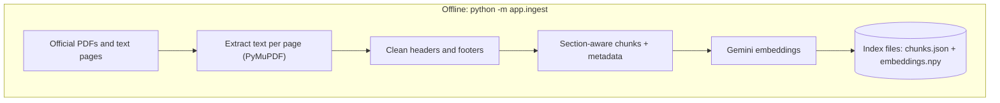
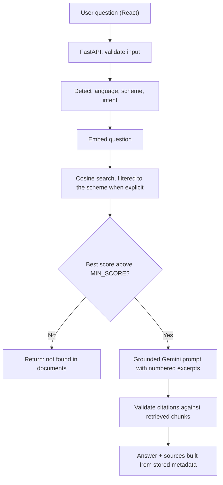

# 🌾 Rural Scheme Advisor

[](https://rural-scheme-advisor-alpha.vercel.app)


**Ask questions about Indian government welfare schemes in English, Hindi or Odia and get answers taken from official documents, with page-level citations. When the documents don't support an answer, the assistant says so instead of guessing.**

👉 **[Try the live app](https://rural-scheme-advisor-alpha.vercel.app)** (the backend sleeps on Render's free tier, so the first question after a quiet period can take 30–60 seconds).

**Schemes covered:** PM-KISAN · PMAY-G · Ayushman Bharat PM-JAY · PM Ujjwala Yojana · MGNREGA

**Jump to:** [Screenshots](#-screenshots) · [How it works](#-how-it-works) · [Design choices](#-design-choices) · [Run locally](#-run-locally) · [Evaluation](#-evaluation) · [Deploy](#-deploy) · [API](#-api)

---

## 📸 Screenshots

| Cited answer | Refuses when it can't find support |
| :---: | :---: |
|  |  |
| Answers carry numbered citations that link to the page they came from. | Questions outside the documents get a clear "not found" instead of a made-up answer. |

| Browse by category | Find schemes for you |
| :---: | :---: |
|  |  |
| Explore the five schemes, filter by category and ask about any of them. | Pick your needs and see suggested schemes with the reason for each. These are suggestions, not an eligibility decision. |

<details>
<summary><b>💬 Try these questions</b></summary>

- *Who is eligible for PM-KISAN?*
- *How many days of work can I get under MGNREGA?*
- *What is PMAY-G?*
- *मनरेगा में साल में कितने दिन काम मिलता है?* (Hindi)
- *What is the capital of France?* (out of scope, so it should refuse)

Change the language selector at the top right to get the answer in Hindi or Odia, or leave it on **Auto-detect**.

</details>

---

## 🧭 How it works

Two pipelines: an offline one that prepares the knowledge base, and an online one that answers each question.





---

## 🛡️ Design choices

- **Citations come from the backend, not the LLM.** The model only writes `[n]` markers. Invalid markers are stripped, and an answer with no valid citation is refused.
- **Abstention.** If no chunk reaches `MIN_SCORE`, the LLM is never called.
- **Prompt-injection hygiene.** Retrieved excerpts are marked as untrusted data in the system prompt.
- **Index is a committed file** (NumPy cosine search) instead of a hosted vector database, so deployment needs no persistent disk. At this scale (thousands of chunks) that is fast and simple. A vector database would be the next step as the corpus grows.
- **Hosted embeddings** (Gemini) keep the backend small enough for a free Render instance. Hindi and Odia questions can retrieve English passages because the embedding model is multilingual.
- **Recommendations** are transparent rule matching on scheme tags, and explicitly *not* an eligibility decision.
- **Honest limits:** Romanised Hindi ("kaun eligible hai") is detected as English; sessions are in memory (single instance); there is no OCR for scanned PDFs; answers reflect the indexed documents, which may not be the latest rules.

| Layer | Technology |
| --- | --- |
| Frontend | React + Vite, hosted on Vercel |
| Backend | FastAPI + Pydantic, Docker, hosted on Render |
| Ingestion | PyMuPDF, custom cleaning and section-aware chunking |
| Retrieval | Gemini multilingual embeddings, NumPy cosine search |
| Generation | Gemini API with backend-validated citations |
| Tests | pytest (retrieval, chunking, citations, API) |

---

## 🚀 Run locally

Prerequisites: Python 3.11+, Node 18+, a free Gemini API key from https://aistudio.google.com/apikey

```bash
# 1. Backend
cd backend
python -m venv .venv && source .venv/bin/activate        # Windows: .venv\Scripts\activate
pip install -r requirements.txt
cp .env.example .env                                      # then put your GEMINI_API_KEY in it

# 2. Add official documents (see below), then build the index
python -m app.ingest

# 3. Start the API
uvicorn app.main:app --reload                             # http://localhost:8000/docs

# 4. Frontend (new terminal)
cd frontend
cp .env.example .env.local
npm install
npm run dev                                               # http://localhost:5173
```

Run the tests (no API key needed): `cd backend && pytest`

<details>
<summary><b>📄 Adding documents</b></summary>

1. Download official documents (guidelines, FAQs, operational guidelines) from each scheme's government portal.
2. Place them as `backend/data/raw/<scheme_id>/<file>.pdf` using ids: `pm_kisan`, `pmay_g`, `ayushman_bharat`, `ujjwala`, `mgnrega`.
3. Optionally record each file's official URL in `backend/data/sources.json` (`"pm_kisan/guidelines.pdf": {"url": "https://..."}`) so citations link to the exact source. Otherwise the scheme's portal link is used.
4. Run `python -m app.ingest`, then commit `backend/data/index/`.

Plain-text sources also work: put a UTF-8 `.txt` file in the scheme's folder. This is useful for web pages that can't be saved as a text-based PDF. A `.txt` file counts as page 1 in citations.

`python -m app.ingest` reuses embeddings that are already saved in the index and only embeds new or changed chunks, so adding a document is quick and cheap. The Gemini free tier limits embedding requests per minute and per day. The script paces itself and waits when it hits the per-minute limit.

Raw PDFs are git-ignored by default: check each document's redistribution terms before committing them.

</details>

---

## 📊 Evaluation

`evaluation/dataset.csv` holds 43 answerable questions (direct, paraphrased, Hindi and Odia) and 7 out-of-scope questions.

```bash
python evaluation/evaluate.py --check   # offline: does each expected keyword exist in the indexed documents?
python evaluation/evaluate.py           # Recall@K, MRR, per-type results, MIN_SCORE sweep
```

A retrieved chunk counts as relevant if it comes from the right scheme and contains one of the row's expected keywords. These numbers therefore measure retrieval with a keyword-based proxy for relevance, not human-judged answer quality. The script also prints a `MIN_SCORE` sweep showing how many answerable questions are kept and how many out-of-scope questions are refused at each threshold.

| Metric | Result |
| --- | --- |
| Recall@5 | _to measure_ |
| MRR | _to measure_ |
| Out-of-scope questions refused | _to measure_ |
| Answer faithfulness (manual review of N answers) | _to measure_ |
| Citation accuracy (manual review) | _to measure_ |

---

## ☁️ Deploy

<details>
<summary><b>Backend on Render</b></summary>

1. Push the repo to GitHub (make sure `backend/data/index/` is committed).
2. Render → New → Blueprint → select the repo (uses `render.yaml`), or New Web Service → Docker, root directory `backend`.
3. Set secrets in the Render dashboard: `GEMINI_API_KEY`, and `ALLOWED_ORIGINS` (your Vercel URL with `https://`, no trailing slash).
4. Check `https://<your-service>.onrender.com/health` → `"index_loaded": true`.

Free instances sleep when idle, so the first request after a break is slow.

</details>

<details>
<summary><b>Frontend on Vercel</b></summary>

1. Vercel → Add New Project → import the repo, set **Root Directory** to `frontend`.
2. Add env var `VITE_API_URL` = your Render URL.
3. Deploy, then put the Vercel URL into the backend's `ALLOWED_ORIGINS` and redeploy the backend.

The API key lives only in Render's secret settings, never in React or Git.

</details>

---

## 🔌 API

| Endpoint | Purpose |
| --- | --- |
| `POST /api/chat` | `{question, session_id, language?}` → answer, status, sources |
| `GET /api/schemes`, `/api/schemes/{id}`, `/api/categories` | Scheme catalogue |
| `POST /api/recommendations` | `{needs[], occupation?}` → suggested schemes with reasons |
| `GET /health` | Service and index status |

## ⚠️ Disclaimer

Answers are generated from the indexed documents and may not reflect the latest rules. This is not an official source or an eligibility decision. Confirm on the official scheme portal or at your local office.
