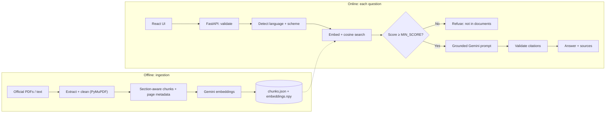
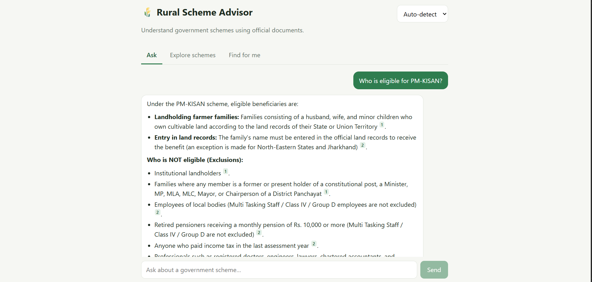
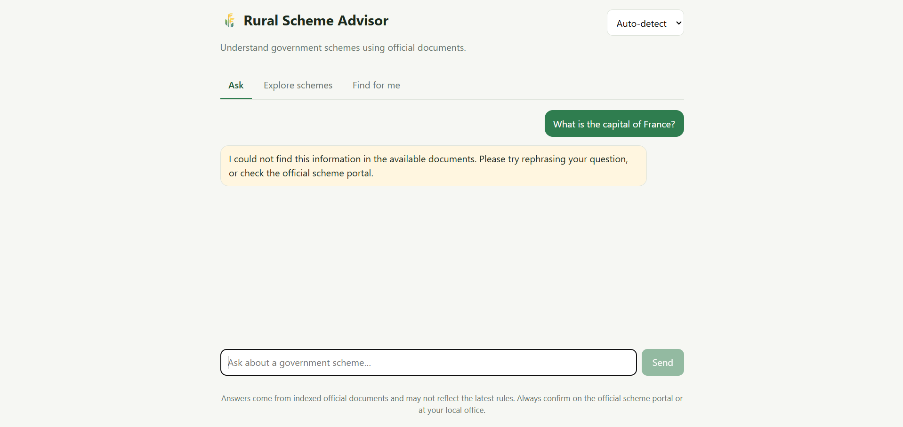
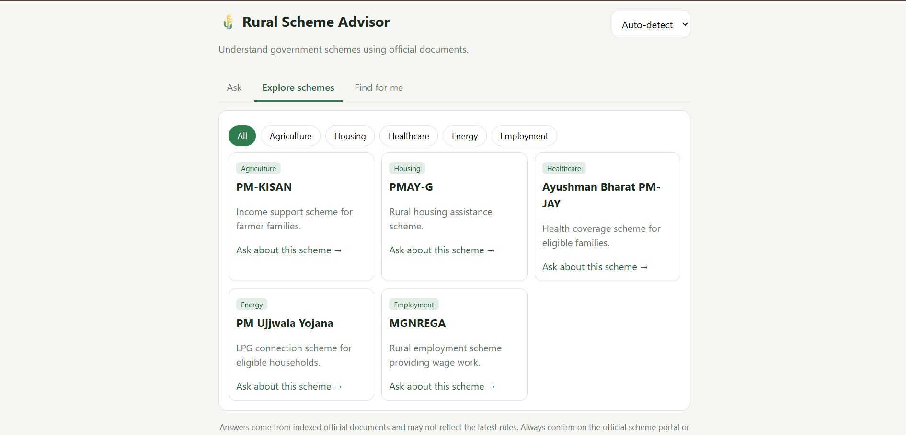
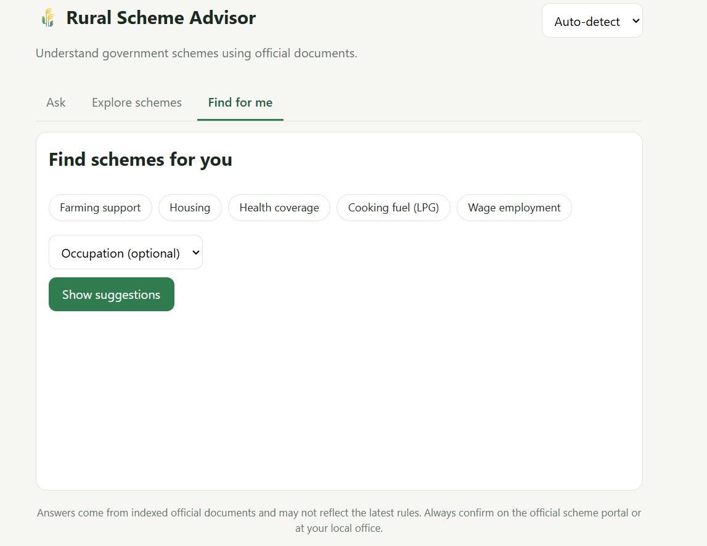

# 🌾 Rural Scheme Advisor

[](https://rural-scheme-advisor-alpha.vercel.app)


**A multilingual (English · हिन्दी · ଓଡ଼ିଆ) question-answering assistant for Indian government welfare schemes. Every answer is grounded in official documents and cites the exact page. When the documents don't support an answer, it says so instead of guessing.**

👉 **[Try the live app](https://rural-scheme-advisor-alpha.vercel.app)** · the backend sleeps on Render's free tier, so the first question after a quiet period can take 30–60 seconds.

**Jump to:** [Why](#-why-this-project) · [How it works](#-how-it-works) · [Screenshots](#-screenshots) · [Evaluation](#-evaluation) · [Limitations](#-known-limitations) · [Future improvements](#-future-improvements) · [Run it](#-run-it-yourself)

---

## 🎯 Why this project

Information about schemes like PM-KISAN, PMAY-G, Ayushman Bharat, Ujjwala and MGNREGA is spread across long PDFs written in official language, mostly in English. The people who need these schemes most often can't read them easily.

A general chatbot is risky here: a confident wrong answer about eligibility or benefits can cost someone real money or a missed deadline. So the goals were:

- **Make official documents answerable** in plain language, in English, Hindi and Odia.
- **Never make things up.** Every answer must point to the page it came from, and unsupported questions must be refused.
- **Prove it works.** Measure retrieval quality instead of just demoing a few good examples.
- **Keep it free to run and deploy**, since the intended users are not paying for infrastructure.

Scope: **5 schemes, 7 official documents, about 490 indexed passages.**

---

## 🧠 How it works

Two pipelines: an offline one that prepares the knowledge base, and an online one that answers each question.



### Tech stack

| Layer | Technology |
| --- | --- |
| Frontend | React + Vite, hosted on Vercel |
| Backend | FastAPI + Pydantic, Docker, hosted on Render |
| Ingestion | PyMuPDF, custom header/footer cleaning, section-aware chunking |
| Retrieval | Gemini multilingual embeddings, NumPy cosine search |
| Generation | Gemini API with backend-validated citations |
| Tests | pytest (retrieval, chunking, citation validation, API) |

### Engineering decisions

| Decision | Why it matters |
| --- | --- |
| **Citations are built by the backend, not the LLM** | The model only writes `[n]` markers. The server validates each one against the retrieved passages, drops invalid ones, and refuses an answer with no valid citation. A source can never be invented. |
| **Relevance threshold tuned from data** | If no passage scores above `MIN_SCORE`, the LLM is never called. The threshold (0.6) was chosen from a sweep over the evaluation set, not guessed. This is the first line of defence against hallucination, and it also saves cost. |
| **Measured, not assumed** | A 50-question evaluation set reports Recall@5 of 0.98 and MRR of 0.88, and shows exactly where retrieval is weaker (paraphrased questions). |
| **Cross-lingual retrieval** | Hindi and Odia questions retrieve English passages through multilingual embeddings, and the answer is written in the user's language. |
| **Prompt-injection hygiene** | Retrieved text is marked as untrusted data in the system prompt; user input is validated and rate-limited. |
| **Deploys with no database** | The vector index is a committed NumPy file with cosine search. It is fast at this scale and needs no persistent disk, so it runs free on Render and Vercel. |
| **Resilient to a free-tier API** | Ingestion paces embedding calls and caches vectors, so adding a document only embeds new chunks. The chat path retries on 429/503 errors. |

---

## 📸 Screenshots

| Cited answer | Refuses when it has no support |
| :---: | :---: |
|  |  |
| Numbered citations link to the document, page and section. | Out-of-scope questions get a clear "not found" instead of a made-up answer. |

| Browse schemes | Find schemes for you |
| :---: | :---: |
|  |  |
| Filter the five schemes by category and ask about any of them. | Pick needs and see suggested schemes with the reason. These are suggestions, not an eligibility decision. |

<details>
<summary><b>💬 Try these questions</b></summary>

- *Who is eligible for PM-KISAN?*
- *How many days of work can I get under MGNREGA?*
- *What is PMAY-G?*
- *मनरेगा में साल में कितने दिन काम मिलता है?* (Hindi)
- *What is the capital of France?* (out of scope, so it should refuse)

</details>

---

## 📊 Evaluation

`evaluation/dataset.csv` contains 43 answerable questions (direct, paraphrased, Hindi, Odia) and 7 out-of-scope questions. A retrieved passage counts as relevant if it comes from the right scheme and contains an expected keyword. So these numbers measure retrieval under a **keyword-based proxy for relevance**, not human-judged answer quality.

| Metric (K = 5) | Result |
| --- | --- |
| **Recall@5** | **0.977** (42 of 43 answerable questions) |
| **MRR** | **0.876** |

| Question type | n | Recall@5 | MRR |
| --- | ---: | ---: | ---: |
| Direct | 32 | 1.000 | 0.932 |
| Paraphrased | 6 | 0.833 | 0.556 |
| Hindi | 4 | 1.000 | 0.875 |
| Odia | 1 | 1.000 | 1.000 |

**Choosing the refusal threshold.** The highest top-1 similarity among out-of-scope questions was 0.557, and the lowest among answerable ones was 0.673. Sweeping `MIN_SCORE` shows a clean gap:

| MIN_SCORE | Answerable kept | Out-of-scope refused |
| ---: | ---: | ---: |
| 0.50 | 100% | 14% |
| 0.55 | 100% | 86% |
| **0.60 (chosen)** | **100%** | **100%** |
| 0.65 | 100% | 100% |
| 0.70 | 95% | 100% |

**What this tells me**
- Direct questions are retrieved reliably. **Paraphrased questions are the weak spot** (the right passage is found, but ranked lower), which points to hybrid retrieval and a re-ranker as the next step.
- The threshold was tuned on the same 50 questions, so the clean separation is optimistic. Real users will phrase things differently. The Hindi and Odia samples are small (4 and 1), so those numbers show it works, not how well.

```bash
python evaluation/evaluate.py --check   # offline: is the expected evidence in the index?
python evaluation/evaluate.py           # Recall@K, MRR, per-type results, MIN_SCORE sweep
```

---

## ⚠️ Known limitations

- Retrieval of paraphrased questions is weaker than direct ones (see evaluation).
- Romanised Hindi ("kaun eligible hai") is detected as English.
- Sessions are kept in memory, so the backend runs as a single instance.
- No OCR: scanned PDFs are not supported.
- Answers reflect the indexed documents, which may not be the latest rules.
- The Ayushman Bharat source is a process document, so eligibility questions for it are weaker than for other schemes.
- Evaluation uses a keyword proxy for relevance and has not been checked by human reviewers.

## 🔮 Future improvements

- [ ] Hybrid retrieval (keyword + embeddings) and a re-ranker to improve paraphrased questions.
- [ ] Human-judged evaluation of answer faithfulness and citation accuracy, beyond the keyword proxy.
- [ ] Add more schemes and better source documents (e.g. the full PM-JAY operations manual).
- [ ] Move to a vector database and persistent sessions as the corpus and traffic grow.
- [ ] Voice input and spoken answers for low-literacy users.
- [ ] OCR support for scanned documents.
- [ ] Better Romanised Hindi / Hinglish handling.
- [ ] Scheduled re-ingestion so answers track updated guidelines.
- [ ] Support more Indian languages.

---

## 🚀 Run it yourself

<details>
<summary><b>Local setup</b></summary>

Prerequisites: Python 3.11+, Node 18+, a free Gemini API key from https://aistudio.google.com/apikey

```bash
# 1. Backend
cd backend
python -m venv .venv && source .venv/bin/activate        # Windows: .venv\Scripts\activate
pip install -r requirements.txt
cp .env.example .env                                      # put your GEMINI_API_KEY in it

# 2. Build the index (documents go in backend/data/raw/<scheme_id>/)
python -m app.ingest

# 3. Start the API
uvicorn app.main:app --reload                             # http://localhost:8000/docs

# 4. Frontend (new terminal)
cd frontend
cp .env.example .env.local
npm install
npm run dev                                               # http://localhost:5173
```

Tests (no API key needed): `cd backend && pytest`

</details>

<details>
<summary><b>Adding documents</b></summary>

1. Download official documents from each scheme's government portal.
2. Place them as `backend/data/raw/<scheme_id>/<file>.pdf` using ids `pm_kisan`, `pmay_g`, `ayushman_bharat`, `ujjwala`, `mgnrega`. Plain UTF-8 `.txt` files also work and count as page 1.
3. Optionally record each file's official URL in `backend/data/sources.json` so citations link to the exact source.
4. Run `python -m app.ingest` (only new or changed chunks are embedded), then commit `backend/data/index/`.

Raw PDFs are git-ignored by default: check each document's redistribution terms before committing them.

</details>

<details>
<summary><b>Deploy (Render + Vercel)</b></summary>

**Backend (Render):** New → Blueprint → select the repo (`render.yaml`). Set `GEMINI_API_KEY` and `ALLOWED_ORIGINS` (your Vercel URL with `https://`, no trailing slash). Check `/health` shows `"index_loaded": true`.

**Frontend (Vercel):** import the repo with **Root Directory** `frontend` and set `VITE_API_URL` to the Render URL.

The API key lives only in Render's secret settings, never in React or Git.

</details>

<details>
<summary><b>API reference</b></summary>

| Endpoint | Purpose |
| --- | --- |
| `POST /api/chat` | `{question, session_id, language?}` → answer, status, sources |
| `GET /api/schemes`, `/api/schemes/{id}`, `/api/categories` | Scheme catalogue |
| `POST /api/recommendations` | `{needs[], occupation?}` → suggested schemes with reasons |
| `GET /health` | Service and index status |

</details>

---

*Answers are generated from the indexed documents and may not reflect the latest rules. This is not an official source or an eligibility decision. Confirm on the official scheme portal or at your local office.*
